# SKaiNET

SKaiNET is an open-source multiplatform AI framework that helps developers build apps with local, **on-device AI** — without having to choose between developer simplicity and native performance.

It is built around a device-first prototyping philosophy: developers should be able to experiment directly on the devices where their AI experiences will actually run, using real hardware constraints, local execution, and platform-native capabilities from the start.

SKaiNET gives developers a clean, practical way to work with data, neural networks, tooling, and compilation across platforms, while aiming for performance close to the hardware. The goal is not just to run AI locally, but to make local AI development accessible, portable, and fast enough for real-world apps.

* Built entirely in Kotlin for a seamless developer experience
* Focused on exceptional efficiency and strong portability
* Provides a user-friendly API that simplifies building and experimenting with ML models
* Integrates smoothly with existing Kotlin and JVM-based projects
* Designed to empower software developers, not only data science specialists
* Balances power, flexibility, and accessibility for next-generation ML development

🌐 [skainet.sk](https://skainet.sk)

## The Ecosystem

### Core

<a href="https://github.com/SKaiNET-developers/SKaiNET"><picture><source media="(prefers-color-scheme: dark)" srcset="https://raw.githubusercontent.com/SKaiNET-developers/.github/main/profile/assets/cards/skainet-dark.svg">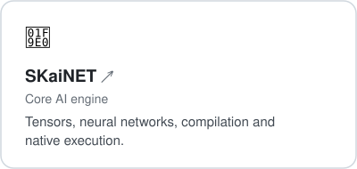</picture></a>
<a href="https://github.com/SKaiNET-developers/SKaiNET-transformers"><picture><source media="(prefers-color-scheme: dark)" srcset="https://raw.githubusercontent.com/SKaiNET-developers/.github/main/profile/assets/cards/transformers-dark.svg">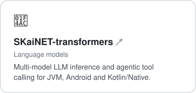</picture></a>
<a href="https://github.com/SKaiNET-developers/SKaiNET-audio"><picture><source media="(prefers-color-scheme: dark)" srcset="https://raw.githubusercontent.com/SKaiNET-developers/.github/main/profile/assets/cards/audio-dark.svg">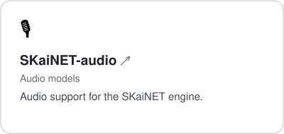</picture></a>
<a href="https://github.com/SKaiNET-developers/SKaiNET-rag"><picture><source media="(prefers-color-scheme: dark)" srcset="https://raw.githubusercontent.com/SKaiNET-developers/.github/main/profile/assets/cards/rag-dark.svg">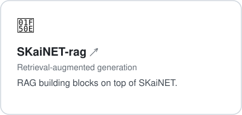</picture></a>

### Learn & Explore

<a href="https://github.com/SKaiNET-developers/skainet-notebook"><picture><source media="(prefers-color-scheme: dark)" srcset="https://raw.githubusercontent.com/SKaiNET-developers/.github/main/profile/assets/cards/notebook-dark.svg">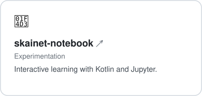</picture></a>
<a href="https://github.com/SKaiNET-developers/SKaiNET-examples"><picture><source media="(prefers-color-scheme: dark)" srcset="https://raw.githubusercontent.com/SKaiNET-developers/.github/main/profile/assets/cards/examples-dark.svg">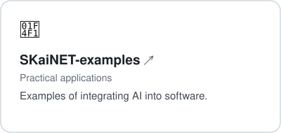</picture></a>
<a href="https://github.com/SKaiNET-developers/miKrograd"><picture><source media="(prefers-color-scheme: dark)" srcset="https://raw.githubusercontent.com/SKaiNET-developers/.github/main/profile/assets/cards/mikrograd-dark.svg">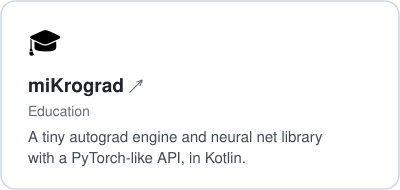</picture></a>
<a href="https://github.com/SKaiNET-developers/SKaiNET-coding-skills"><picture><source media="(prefers-color-scheme: dark)" srcset="https://raw.githubusercontent.com/SKaiNET-developers/.github/main/profile/assets/cards/coding-skills-dark.svg">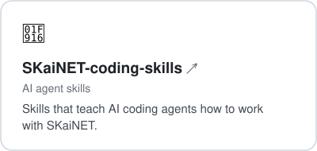</picture></a>

### Package & Deploy

<a href="https://github.com/SKaiNET-developers/SKaiNET-cartridge"><picture><source media="(prefers-color-scheme: dark)" srcset="https://raw.githubusercontent.com/SKaiNET-developers/.github/main/profile/assets/cards/cartridge-dark.svg">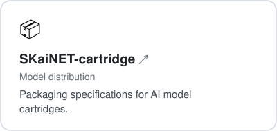</picture></a>
<a href="https://github.com/SKaiNET-developers/SKaiNET-embedded"><picture><source media="(prefers-color-scheme: dark)" srcset="https://raw.githubusercontent.com/SKaiNET-developers/.github/main/profile/assets/cards/embedded-dark.svg">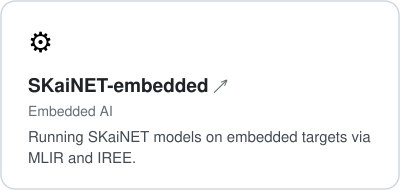</picture></a>

Related: [SKaiNET-cartridge-blueprints](https://github.com/SKaiNET-developers/SKaiNET-cartridge-blueprints) · [SKaiNET-embedded-vendors](https://github.com/SKaiNET-developers/SKaiNET-embedded-vendors) · [torq-compiler](https://github.com/SKaiNET-developers/torq-compiler)

### Research & Quality

<a href="https://github.com/SKaiNET-developers/SKaiNET-research"><picture><source media="(prefers-color-scheme: dark)" srcset="https://raw.githubusercontent.com/SKaiNET-developers/.github/main/profile/assets/cards/research-dark.svg">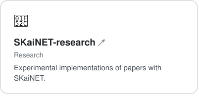</picture></a>
<a href="https://github.com/SKaiNET-developers/SKaiNET-labs"><picture><source media="(prefers-color-scheme: dark)" srcset="https://raw.githubusercontent.com/SKaiNET-developers/.github/main/profile/assets/cards/labs-dark.svg">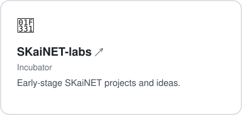</picture></a>
<a href="https://github.com/SKaiNET-developers/federated-learning"><picture><source media="(prefers-color-scheme: dark)" srcset="https://raw.githubusercontent.com/SKaiNET-developers/.github/main/profile/assets/cards/federated-learning-dark.svg">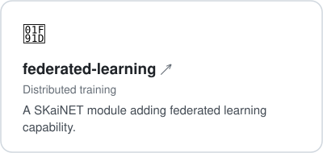</picture></a>
<a href="https://github.com/SKaiNET-developers/gradienttracer"><picture><source media="(prefers-color-scheme: dark)" srcset="https://raw.githubusercontent.com/SKaiNET-developers/.github/main/profile/assets/cards/gradienttracer-dark.svg">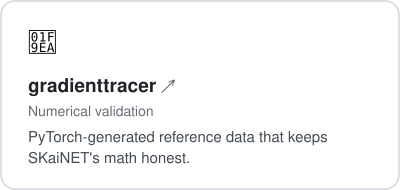</picture></a>

Related: [skainet-ground-truth](https://github.com/SKaiNET-developers/skainet-ground-truth)
